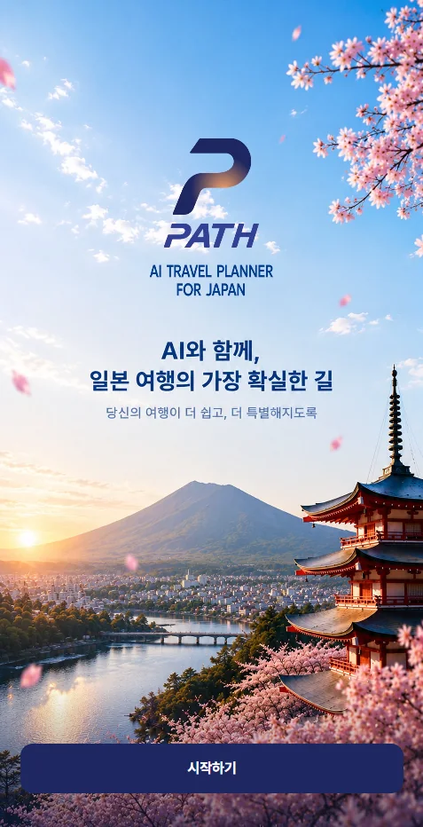
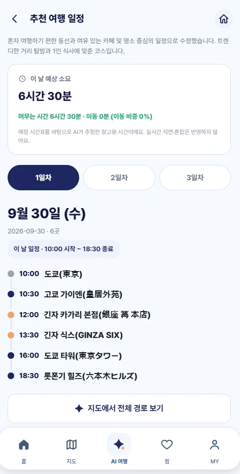
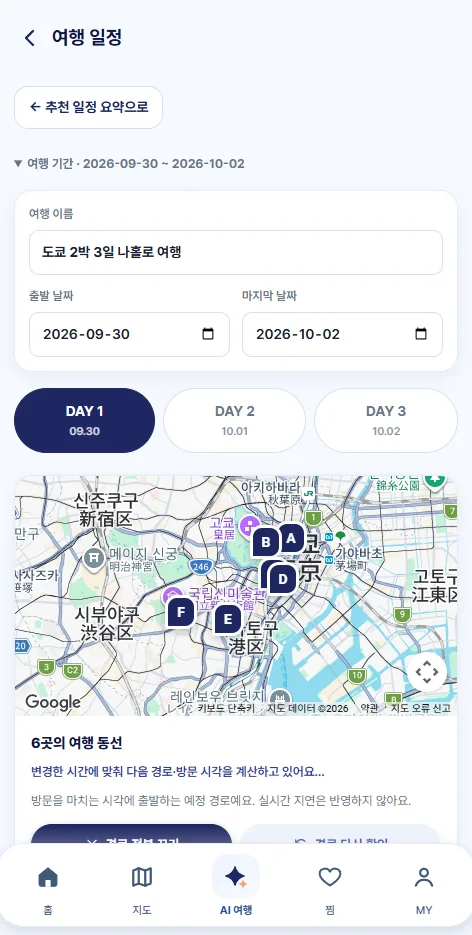
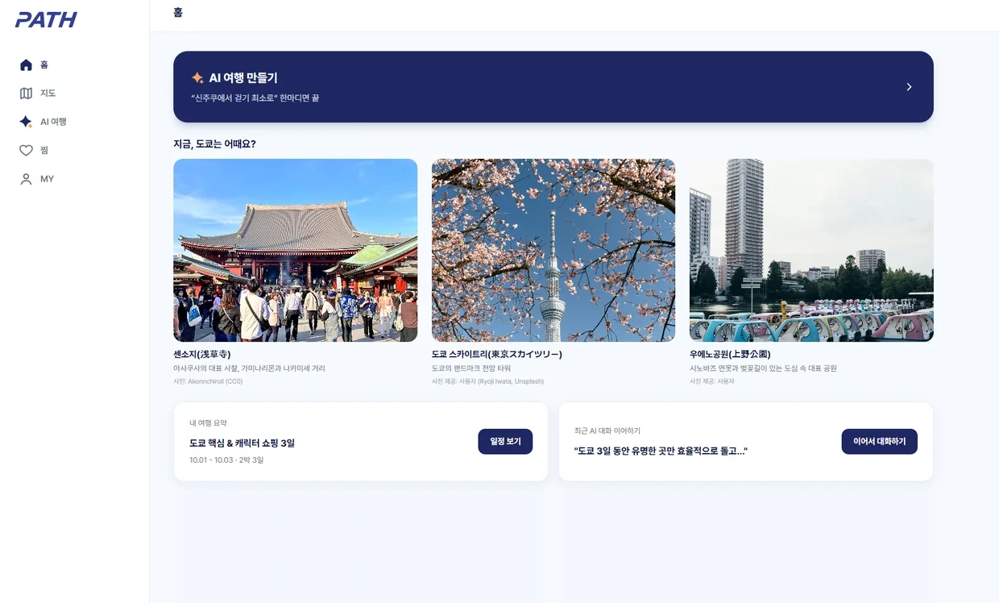

# PATH — AI와 대화하며 완성하는 일본 여행 플래너

> "신주쿠에서 걷기 최소로" 한마디면 끝.
> AI가 구글맵과 실시간 교통 정보를 바탕으로 동선을 직접 확인해 여행 일정을 짜 주는 모바일 웹 서비스입니다.

**🔗 서비스 바로가기** · https://wa26bteam01.yjjob.kr/splash
**🎨 Figma** · https://www.figma.com/design/UMFFJJF0zPpLyxHYHRZlCA/path?node-id=2-3

  
  
  

 

## 📌 프로젝트 개요

| 항목 | 내용 |
| --- | --- |
| 기간 | 2026.09.01 – 2026.09.30 |
| 인원 | 4명 (팀 프로젝트) |
| 담당 | UI/UX 디자인 · 프론트엔드 |
| 플랫폼 | 모바일 웹 (PC 레이아웃 대응) |

 

## 🤔 해결하고 싶었던 문제

여행 일정은 **처음 짜는 것도, 현지에서 바꾸는 것도 번거롭습니다.**
가고 싶은 장소를 고른 뒤에도 동선과 교통편을 따로 찾아야 하고, 계획이 틀어지면 처음부터 다시 검색해야 해요.

PATH는 이 과정을 **대화 한 번**으로 줄이는 것을 목표로 했습니다.

 

## ✨ 주요 기능

### 1. AI 여행 만들기
- 원하는 여행을 자연어로 입력하면 AI가 일정을 만들어 줍니다.
  예: *"내일 오전 9시 신주쿠에서 출발해서 센소지와 스카이트리를 가고 싶어. 부모님과 함께라 많이 걷지 않는 일정으로 만들어 줘."*
- **빠른 조건** 칩으로 도보 최소 · 환승 최소 · 맛집 포함 · 관광 위주 · 여유롭게 · 가족 여행을 한 번에 선택할 수 있어요.
- 처음 쓰는 사용자를 위해 자주 쓰는 요청 예시를 함께 보여 줍니다.

### 2. 추천 여행 일정
- 일차별 탭으로 하루 일정을 시간순 타임라인으로 확인합니다.
- 하루 **예상 소요 시간**과 머무는 시간 · 이동 시간 비율을 함께 보여 줍니다.
- 일정은 대화로 다시 요청해 수정할 수 있습니다.

### 3. 지도에서 동선 확인
- 하루 방문지를 A → F 순서로 지도에 표시하고 전체 경로를 보여 줍니다.
- 방문을 마치는 시각에 맞춰 다음 경로와 방문 시각을 다시 계산합니다.
- 지도 탭에서는 장소 검색과 관광지 · 맛집 · 숙소 필터를 제공합니다.

### 4. 홈 · 찜
- 홈에서 현재 도시의 추천 장소, 내 여행 요약, 최근 AI 대화 이어하기를 바로 확인합니다.
- 마음에 드는 장소를 찜해 카테고리별로 모아 볼 수 있고, 사진과 장소 정보의 출처를 함께 표시합니다.

### 5. PC 레이아웃
모바일 우선으로 설계하고, PC에서는 하단 탭 대신 왼쪽 사이드바 내비게이션으로 전환되도록 대응했습니다.

 

## 🛠 기술 스택

| 구분 | 사용 기술 |
| --- | --- |
| Frontend | React, TypeScript |
| AI | Google Gemini |
| 지도 | Google Maps API |
| Database | MySQL |
| Design | Figma |

 

## 🎨 디자인 포인트

- **입력 부담 줄이기**: 빈 입력창 대신 예시 문장과 조건 칩을 먼저 보여 줘서, 무엇을 써야 할지 고민하지 않고 시작할 수 있게 했습니다.
- **신뢰할 수 있는 결과**: AI가 만든 일정에 예상 소요 시간과 이동 비율을 함께 보여 주고, "실시간 지연은 반영하지 않는다"는 안내를 명시했습니다.
- **현지에서 쓰기 편하게**: 한 손으로 조작하는 상황을 고려해 주요 동작을 하단 탭과 화면 아래쪽 버튼에 배치했습니다.
